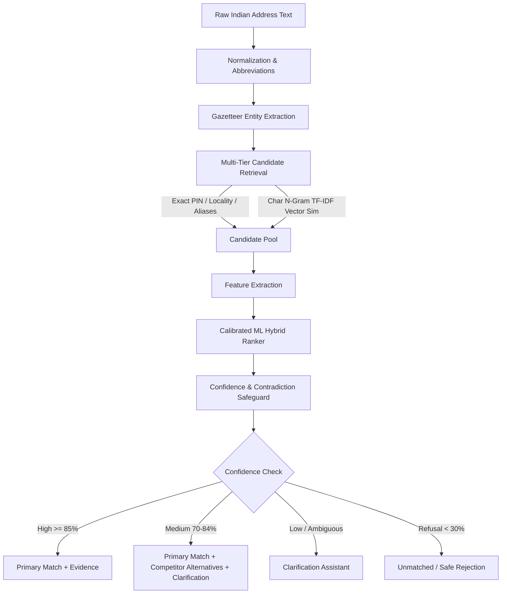

# POSTALIQ System Architecture

## Overview

POSTALIQ is a production-oriented postal identification platform designed to interpret unstructured, noisy, abbreviated, or ambiguously phrased Indian postal addresses and identify the most probable 6-digit Indian PIN code and serving post office with explainable evidence.

## Architectural Layers

1. **Frontend Presentation Layer**:
   - Built on React 19, TypeScript, and Vite.
   - Styled with custom design tokens, warm off-white tones (`#F7F8FA`), midnight navy typography, and indigo accents (`#263CDB`).
   - Integrated OpenStreetMap with Leaflet for GPS-verified postal survey nodes.
   - Recharts visual metrics for administrative analytics and error feedback review queues.

2. **Backend API Layer**:
   - Python 3.12 with FastAPI, Pydantic v2 schemas, and asynchronous connection handling.
   - Parameterized database operations through SQLAlchemy ORM.
   - Session-isolated search history for user privacy.
   - Cryptographic JWT bearer tokens and Bcrypt password hashing for administration endpoints.

3. **Intelligence & ML Pipeline**:
   - **Pre-processing**: Unicode NFKD normalization, phone number and URL redaction, case-folding, and regex abbreviation expansion (e.g. `opp` → `opposite`, `flt` → `flat`, `lyt` → `layout`, `ka` → `karnataka`).
   - **Entity Extraction**: Gazetteer matching against administrative states, union territories, districts, and prominent cities, with Indian 6-digit PIN regex `^[1-9][0-9]{5}$`.
   - **Candidate Retrieval**: Multi-tier indexing combining exact PIN matches, alias gazetteer lookups, and character 3–5 gram TF-IDF cosine similarity.
   - **Feature Extraction**: Computes text similarity, locality match, district agreement, state agreement, PIN consistency, and office type weights.
   - **Contradiction Safeguards**: Explicitly penalizes matches where input directly contradicts candidate district, state, or PIN, preventing high textual similarity from overriding factual conflict.
   - **Calibrated Ranking**: Machine learning ranker trained on representative Indian address patterns with margin scoring.
   - **Explainability**: Generates specific human-readable rationales (e.g., exact locality, spelling normalization, district agreement, GPS verification).
